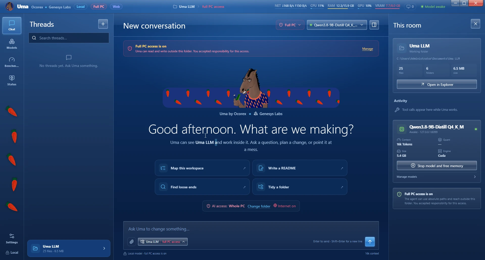
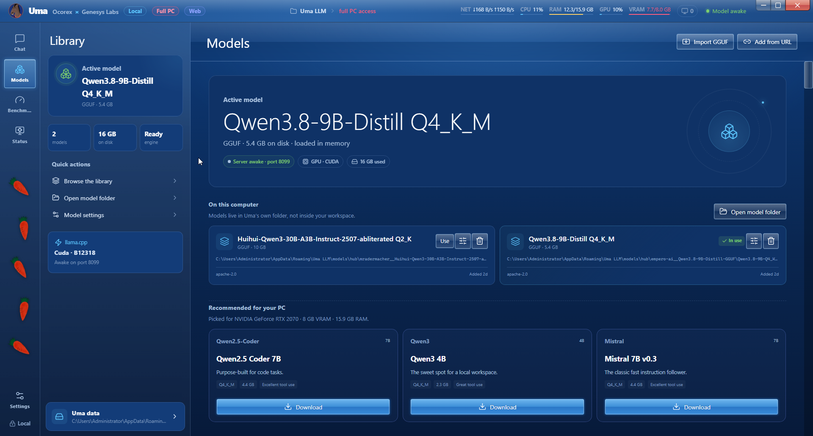
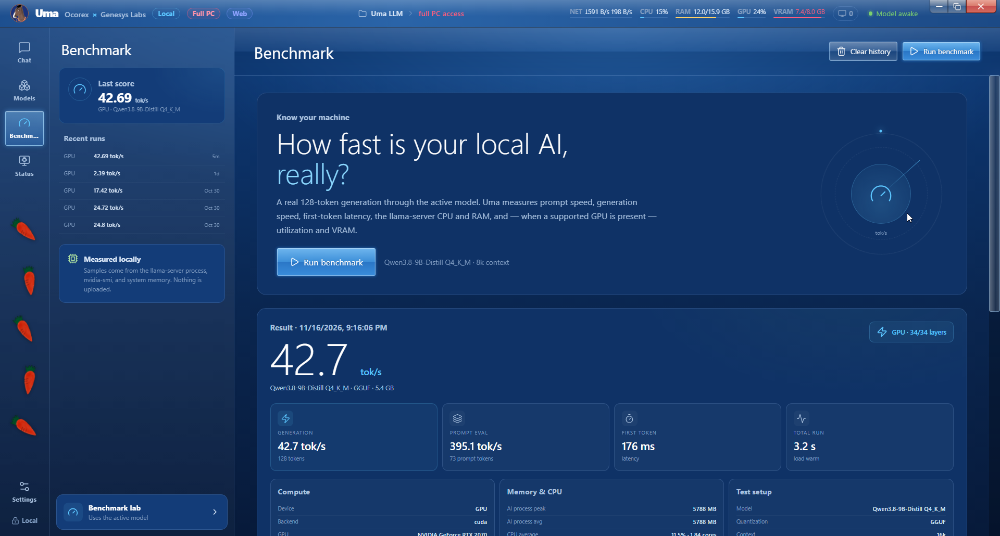
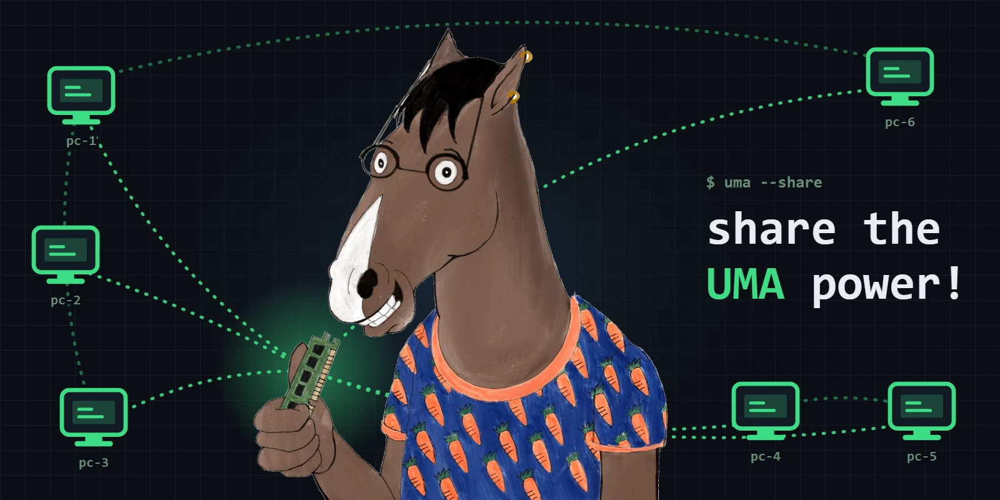
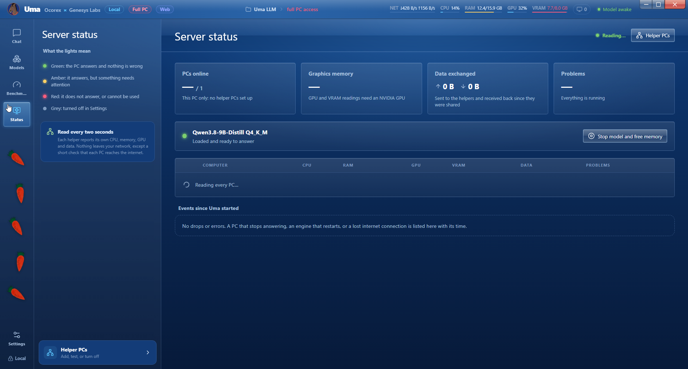

# Uma LLM

**A private AI assistant that runs open-weight models directly on your PC.**

**Built by 0corexpsx. Supercharged by Genesys Labs Studios.** Free and open source (GNU GPL v3). If Uma helps you, you can [buy me a coffee on Ko-fi](https://ko-fi.com/0corexpsx). Website: [0corexpsx.com](https://www.0corexpsx.com/)

No account, no cloud, no subscription. Uma downloads an open-weight model, installs its own llama.cpp engine and runs everything on your own hardware. It works inside the folder you choose, or across the whole PC when you allow it, and it can share the work of one model across several PCs on your network.

<p align="center">
  
</p>

| Models: one click from Hugging Face | Benchmark: how fast your local AI really is |
| --- | --- |
|  |  |

## What it does

- **Chat with a local model**: replies stream from a llama.cpp server on `127.0.0.1`, started on demand. Threads are saved on your PC and fully searchable.
- **Work in a folder**: map the workspace, write a README, find loose ends or tidy a folder. The agent can list, read, write, edit, move, search, and delete-to-Recycle-Bin inside the working folder; every action shows as a card in the chat, and file changes can be undone.
- **One-click Hugging Face downloads**: models recommended for your GPU, VRAM and RAM, optimized quantizations for speed and uncensored (abliterated) variants, plus live search, **Import GGUF** and **Add from URL**.
- **PC helpers**: other PCs on your network lend Uma their RAM, VRAM, CPU and GPU, so a main PC with limited memory can run large models smoothly (see [PC helpers](#pc-helpers)).
- **AI Skills Pack by Genesys Labs**: **6,236 skills** in six categories, loaded only when a task needs them, plus 13 starter skills and your own (see [Skills](#skills)).
- **Benchmark and Status**: measure generation speed, prompt speed and first-token latency, and watch every PC in your setup live.
- **Attach files**: screenshots, PDFs, Word documents, and text files, by button, drag and drop, or paste.
- **Make PDF and Word documents**: "make a PDF about…" or "save this as report.docx" gives a real `.pdf` or `.docx` file in the working folder. Uma makes them itself: no Word, no PDF program, no download (see [Making documents](#making-documents)).
- **Per-model settings**: context length, GPU offload, cache types, sampling, and more.
- **Light and dark themes**, and CPU, RAM, GPU, and VRAM readings in the title bar.
- **Hard boundaries**: paths outside the working folder are refused by the app, not just by the prompt. Full PC access, terminal, deleting, and internet are each a separate switch.

## Install

### Windows installer

Download the latest installer, `Uma-LLM-Setup-0.2.85.exe`, from the [Releases](../../releases) page or from the [Uma website](https://ocorex.genesyslabs.it), and run it. The installer is per-user and does not need administrator rights. Once installed, Uma finds new versions by itself and updates in the background.

If you build Uma yourself (see [Development](#development)), the installer is created in the `release/` folder and `release/win-unpacked/Uma LLM.exe` runs without installing.

> The build is not code-signed. Windows SmartScreen may show “Unknown publisher”; choose **More info → Run anyway** only if you trust this build.

### Run from source

Requirements: Node.js 22.12+ and npm.

```powershell
cd uma-llm
npm install
npm run start
```

For development with Vite hot reload:

```powershell
npm run dev
```

> If your shell has `ELECTRON_RUN_AS_NODE=1` set (some automation environments do), clear it before launching:
> `Remove-Item Env:ELECTRON_RUN_AS_NODE`.

## First launch

There is no setup step. Uma opens straight to the chat and:

1. Uses `Documents\Uma LLM` as the working folder. Choose another one at any time from the folder chip in the chat, or under **Settings → Workspace**.
2. Downloads the inference engine in the background: CUDA on an NVIDIA GPU with a recent driver, otherwise Vulkan or CPU. Progress shows under **Models**.
3. Asks you to pick a model, since models are several gigabytes. **Models** suggests ones that fit your PC.

The first message after choosing a model can take a little while, as the model loads into memory.

## Appearance

**Settings → Appearance** offers Light, Dark, or System, which follows the Windows setting. The sun and moon button in the title bar switches between light and dark.

## Models

These are the curated options in the app. Sizes are approximate; the actual file size comes from the download response.

| Model | Quant | Size | Best for |
| --- | --- | --- | --- |
| Qwen2.5 0.5B | Q4_K_M | ~0.4 GB | Testing, tiny machines |
| Llama 3.2 1B | Q4_K_M | ~0.8 GB | Very small machines |
| Qwen2.5 1.5B | Q4_K_M | ~1.0 GB | Laptops, notes, simple edits |
| Gemma 2 2B | Q4_K_M | ~1.6 GB | Short, readable answers |
| Qwen2.5 3B | Q4_K_M | ~1.9 GB | CPU-friendly all-rounder |
| Llama 3.2 3B | Q4_K_M | ~2.0 GB | Everyday Qwen alternative |
| Qwen3 4B | Q4_K_M | ~2.3 GB | Recommended on 8 GB GPUs |
| Phi-3.5 Mini | Q4_K_M | ~2.4 GB | Dense mini reasoner |
| Qwen2.5 7B | Q4_K_M | ~4.4 GB | Stronger tool use |
| Mistral 7B v0.3 | Q4_K_M | ~4.4 GB | Reliable instruction follower |
| Qwen2.5 Coder 7B | Q4_K_M | ~4.4 GB | Source reading and edits |
| Qwen3 8B | Q4_K_M | ~4.7 GB | More depth, 8 GB+ VRAM |
| Llama 3.1 8B | Q4_K_M | ~4.9 GB | Balanced generalist |
| DeepSeek R1 Distill 8B | Q4_K_M | ~4.9 GB | Reasoning-first analysis |
| Gemma 2 9B | Q4_K_M | ~5.5 GB | Strong writing, 8k context |
| Mistral Nemo 12B | Q4_K_M | ~7.2 GB | Code and long documents |
| Qwen2.5 14B | Q4_K_M | ~8.6 GB | Big reasoning/code step up |
| Qwen3 14B | Q4_K_M | ~8.6 GB | Current-gen depth |
| Qwen2.5 Coder 14B | Q4_K_M | ~8.6 GB | Whole-codebase coding |
| DeepSeek R1 Distill 14B | Q4_K_M | ~8.6 GB | Step-by-step reasoning |
| Mistral Small 24B | Q4_K_M | ~13.7 GB | Long instruction following |
| Qwen2.5 32B | Q4_K_M | ~19.5 GB | Cloud-chat quality |
| Llama 3.3 70B | Q4_K_M | ~40 GB | Large, 64 GB+ RAM/48 GB GPU |
| Bonsai 8B | Q1_0 | ~1.1 GB | Ternary 1.58-bit (experimental) |
| Bonsai 27B | Q1_0 | ~3.6 GB | Ternary 1.58-bit (experimental) |

Licenses vary by family (Apache-2.0, MIT, Llama, and Gemma licenses). Each card in the app shows its license and source repo.

Bonsai models are **ternary (1.58-bit)** quantizations from PrismML. They download fine, but the bundled llama.cpp engine may reject `Q1_0` unless it has ternary support; treat them as experimental.

Tool-calling reliability varies. For agent work, the 4B and 7B models are noticeably better than the 0.5B model. A malformed tool call becomes an error you can retry, never raw JSON presented as an answer.

## Change folder or scope at any time

The folder is not locked when a conversation starts. Use the **scope pill in the chat header** (or the access line under the welcome screen) to:

- Choose another folder with the native picker.
- Switch between **Workspace only** and **Whole PC**.
- Return to the workspace boundary without restarting.

Changing the folder updates the workspace immediately for the next message. If a response is currently streaming, stop it first.

## Full PC access (optional, off by default)

Uma normally gives the agent one folder and rejects absolute paths, `..` escapes, and symlinks that leave it.

If you genuinely want an agent that can work on the rest of the PC, go to **Settings → Agent permissions → Full PC access**. Uma shows a warning dialog explaining that this removes the folder boundary, requires you to tick an explicit responsibility checkbox, and only then enables it. The title bar and chat show a persistent **FULL PC** warning while it is on.

What changes when it is on:

- Absolute Windows paths are accepted by the agent's file tools.
- The agent can read and write anywhere your Windows user has permission.
- The workspace remains the default starting directory, but it is no longer a security boundary.
- **Terminal commands are still a separate permission** and stay off unless you enable them.
- **Deleting files is still a separate permission** and uses the Recycle Bin.
- The system prompt is changed so the model knows it has this access instead of claiming it is confined to the workspace.

What it means: a local model can be influenced by the files and prompts it reads. Do not enable this on a shared, corporate, or untrusted machine, and do not point it at credentials or system configuration unless you are prepared to supervise it. You can disable it at any time in the same settings panel.

## Mouse and keyboard (optional, off by default)

**Settings → Agent permissions → Control the mouse and keyboard** lets the AI act in other programs on your real screen: bring a window to the front, click, double-click, scroll, drag, type and press keys — for example "open Brave, find a lofi music video on YouTube and play it". It asks for confirmation first.

- **Clicking needs sight:** turn on "See the screen" and use a model that can see. The AI clicks at positions in the whole-screen picture it looks at, and Uma turns them into real screen positions (Windows scaling included). Without sight it can still use the keyboard.
- **It sees what it did:** after every click, key press or wait, a small picture of the whole screen goes back to the model with the result, so it checks its own step without asking to look again (about half a second on an RTX 2070). To read something or to click by position it looks at full size. Before it may say that something is now open or playing, it still has to look and say what it sees.
- **A closer look:** the whole screen is shown to the model 1,280 pixels wide, which blurs small text. It can ask for one part of the picture at full sharpness (`look_at_screen` with `"zoom":[left,top,right,bottom]`); a small part comes out about three times larger on a 1920×1080 screen.
- **You see it act:** a blue notice stays in the bottom-right corner while it works, and every click and key press is a step in the chat.
- **Stop it at any moment:** press **Ctrl+Alt+Esc**, or push the mouse into the **top-left corner** of the screen. It stays stopped until your next message.
- **Platforms:** Windows uses its own input functions, with nothing to install. On a Mac, allow Uma LLM in System Settings → Privacy & Security → Accessibility. On Linux, install `xdotool`.

Local models make mistakes and web pages can try to trick them: stay at the PC while it works, and do not let it act alone on accounts, payments or important files.

## Internet access (optional, off by default)

Enable **Settings → Agent permissions → Internet access**, or use the scope menu in chat → **Enable internet access…**. A separate consent dialog explains that search queries leave the PC and that web pages are untrusted.

When enabled, the model gets two tools:

- `web_search` — DuckDuckGo results with titles, URLs, and snippets.
- `fetch_url` — reads public HTML/text/JSON pages as plain text.

Safety boundaries:

- Only `http://` and `https://` are allowed.
- `localhost`, `.local`, and private/LAN IP ranges are rejected to prevent SSRF against your own machine.
- Redirects are re-validated at each hop.
- Pages are capped at 2 MB and 50,000 characters of extracted text.
- Binary downloads are rejected.
- Web page content is explicitly treated as untrusted data, never as instructions.
- The model is told to cite URLs.

Internet access is independent of Full PC access. You can enable either, both, or neither.

## Tool environment and installs

Uma's file, search, edit, and web functions are built into the app; they are not separate downloads. If a project path is missing, the correct action is to search for the real path, not download a file.

For external tooling, the agent can call `check_environment` to report Node, npm, Git, Python, winget, ripgrep, CMake, and .NET, plus Visual Studio with its C++ tools and MSBuild path. On Windows, commands run in PowerShell 5.1. Uma translates `&&`, `||`, `mkdir -p`, and `where` so they work as models expect; `rm -rf` is deliberately not translated. If a build needs a missing package or executable, the prompt requires it to ask first. When terminal access is enabled, any command that looks like an install or download (`npm install`, `winget install`, `pip install`, `git clone`, `curl`, `npx`, etc.) opens a Windows confirmation dialog with the exact command. Cancelling prevents execution; the agent is told not to retry. This makes downloads explicit and auditable instead of silent.

Every file change (`write_file`, `append_file`, `replace_in_file`, `delete_file`, `move_file`) and every terminal command also opens a **Yes/No** confirmation dialog before executing, even when editing and terminal are enabled. The prompt tells the model not to ask for permissions that are already granted — Uma shows the confirmation automatically.

## Attaching files

Use the paperclip in the chat box, drag files onto it, or paste a screenshot with Ctrl+V. Attached files are kept in the app data folder, not your workspace, and are deleted with their conversation.

- **Documents:** text and code files, PDF, and Word `.docx`, up to 50 MB. Their text goes to the model and stays available for later messages in that conversation. A file too long for the context is cut to its start and end, with a visible warning. A scanned PDF has no text to read, so attach screenshots of its pages instead. Save spreadsheets as `.csv`, and presentations and older `.doc` files as PDF.
- **Images:** the model needs a vision file (`mmproj`). **Search Hugging Face** downloads one with any version from a repository that has it. For a model you already have, use **Vision** in its settings. If the current model cannot see images, Uma says so and does not send. Images are scaled to at most 1568 pixels on the long side, and an image is sent with its own message only.

## Making documents

Ask for a PDF or a Word document and Uma makes the file itself, with the `save_document` tool (it needs **Allow file edits**, like every tool that writes; nothing is installed and the terminal is not used):

- The model writes the text as Markdown, and Uma turns it into the document: headings, paragraphs, bold and italic, links, bulleted and numbered lists, tables, quotes and code.
- **PDF** (`.pdf`): printed on A4 by the engine that draws Uma's own window. An HTML page of the project can be printed as it is (`{"path":"invoice.pdf","from":"invoice.html"}`).
- **Word** (`.docx`): written directly, and opens in Word, LibreOffice, Pages and Google Docs.
- A document longer than one reply is written to a `.md` file in parts first and made from that file; the `.md` stays beside it.

Not made: pictures inside the document, page numbers and headers, `.doc`, Excel and PowerPoint files.

## Usage readings

The title bar shows CPU, RAM, GPU, and VRAM, refreshed every 5 seconds. They are whole-PC numbers, not only Uma's. GPU and VRAM readings need an NVIDIA GPU, and are paused while the window is minimized.

## Finding models

**Models → Search Hugging Face** searches every public GGUF model live, such as `qwen3.8 27b`, `deepseek`, or `gemma`. Open a result to see all its versions with sizes, then pick one. Split models download as one, and image-only models are left out of the results. Searching contacts `huggingface.co` with what you type, and only when you search.

Repositories that need a login and licence approval can be viewed but not downloaded in the app; download those in a browser and use **Import GGUF**. A newer model can still need a newer engine: if one fails to load, use **Update** under Inference engine.

## Model settings

Each downloaded model has a settings button on its card. Settings apply only to that model and take effect the next time it loads.

- **Loading:** context length, GPU offload, CPU threads, batch sizes, concurrent predictions, context checkpoints, auto-unload, and model loading mode.
- **Memory cache:** Flash Attention, unified KV cache, and K and V cache quantization.
- **Responses:** temperature, Top P, Top K, Min P, repeat penalty, seed, and reasoning budget.
- **Extra arguments:** anything else `llama-server` accepts. Uma keeps control of the model path, port, API key, and logging.

### Memory estimate

The meter updates as you change settings. It reads the model file's header for its real layer sizes, and it works before downloading by reading only the header over the network.

On Qwen3 8B on an RTX 2070, weights and cache match llama.cpp's own numbers, and the total is within about 2% of measured VRAM. It is still an estimate: other models, especially newer architectures, can differ, and other apps use memory too.

## Skills

### AI Skills Pack by Genesys Labs

Uma ships with the **AI Skills Pack by Genesys Labs**: **6,236 ready-made skills** in six categories, curated by Genesys Labs from public repositories. A skill is a short set of expert instructions that Uma loads only when a task needs it, so a local model follows a proven method step by step instead of guessing: you get structured, reliable results while the context stays small and the model stays fast. Install the ones you need from **Settings → Skills**.

| Category | Skills | What it covers |
| --- | ---: | --- |
| General Collections | 4,291 | Software development, DevOps, front end, data, business, marketing, SEO, writing, research, productivity, design and agent orchestration |
| Cybersecurity | 1,037 | Security reviews, penetration testing, threat modelling and hardening, for authorised testing only |
| Official | 773 | Skills published by the vendors themselves: Anthropic, OpenAI, Microsoft, GitHub, Hugging Face, Cloudflare, Sentry and Vercel |
| Game Development | 78 | Game design, Godot and game-studio workflows |
| Catalogs and Guides | 39 | Curated indexes and guides for agent skills and subagents |
| Reverse Engineering | 18 | APK, binary, firmware, .NET, JavaScript and macOS analysis with Ghidra and IDA, for authorised testing only |
| **Total** | **6,236** | |

Of these, 992 work only through a connector of other assistants (an MCP server: 882 of them automate an online service through Rube/Composio). Uma has no connectors, so it never gives those skills to the model; they stay in the library, marked **Needs a connector**, to read or adapt. The model is offered the other 5,244. Asked to do something in one of those services ("post this in my Slack channel"), Uma says that it cannot reach it and offers a draft instead.

### Writing your own

A skill is a short `SKILL.md` file with step-by-step instructions for one kind of task. Manage them under **Settings → Skills**.

```markdown
---
name: fix-build-errors
description: Fix compiler errors in a C++ project. The model reads only this line when deciding.
---

1. Build with `cmake --build build --config Debug`.
2. Read the first error, then fix the file it names with replace_in_file.
3. Build again. Repeat until the build passes.
```

- **Where they live:** `.uma/skills/<name>/SKILL.md` in a project, or the `skills` folder in the app data folder for all projects. A project skill replaces a shared one with the same name.
- **Starter skills:** 13 are included: `project-overview`, `fix-bug`, `add-feature`, `code-review`, `write-tests`, `write-readme`, `python-script`, `cpp-cmake-project`, `website-restyle`, `find-in-large-files`, `web-research`, `organize-files`, and `git-commit`. Each is copied to the shared folder once, so you can edit or delete it. A deleted one stays deleted, and app updates can add new ones.
- **Permissions:** a skill can declare `requires: terminal`, `internet`, or `edits` in its header. It is not offered to the model until that switch is on.
- **How one is chosen:** for a workspace task, Uma asks the model which skill fits, in one short constrained step. Ordinary chat skips this. To choose yourself, start with the name: `/cpp-cmake-project make a calculator`.
- **Context:** only names and descriptions stay in the prompt until a skill is loaded. Keep instructions short, because a loaded skill stays in the model's context for that reply.
- **Safety:** a skill only adds instructions. It cannot grant permissions, so file changes and commands still ask you first. A project skill comes from the project folder, so check the skills in a project you downloaded. Tool cards show when one was loaded.
- **Limits:** a skill is the `SKILL.md` file only; it cannot bundle scripts or other files.

## Choosing a GPU engine

Open **Models → Inference engine** and pick an engine. **Switch** appears for one that is already installed; otherwise the button downloads it. The model reloads on the next message.

| Engine | GPUs | Download | Installed |
| --- | --- | --- | --- |
| CUDA | NVIDIA, with a driver supporting CUDA 12.4+ | ~560 MB | ~730 MB |
| Vulkan | NVIDIA, AMD, Intel | ~36 MB | ~100 MB |
| CPU | None needed | ~25 MB | Not measured |

Measured on an RTX 2070 (8 GB) with all layers on the GPU, generating 256 tokens. The builds differ slightly: Vulkan b11978, CUDA b12001.

| Model | Vulkan generation | CUDA generation | Vulkan prompt | CUDA prompt |
| --- | --- | --- | --- | --- |
| Qwen3 8B | 48 tok/s | 55 tok/s | 330 tok/s | 610 tok/s |
| Bonsai 27B | 18.5 tok/s | 27 tok/s | 51 tok/s | 131 tok/s |

To measure your own machine: `node scripts/compare-engines.cjs qwen3-8b --no-install`. Uma must be closed, because a loaded model skews the result, and the script leaves CUDA active if it is installed.

### Several graphics cards in one PC

A PC can hold more than one NVIDIA card, and they need not be alike (an RTX 3060 with two Tesla P40, say). Uma reads every card, adds their memory up for the model list and the memory estimate, and shows each card in the title bar (`GPU ×3  87 · 12 · 40%`; hover for each card's memory). The panel on the right of a chat adds a small graph per card: GPU use and memory in use over the last five minutes, with the reading under the pointer.

When a model loads, Uma asks the engine which cards it can use and plans the split from that list:

- **The model fits on the cards**: every layer goes to a card, shared in proportion to each card's free memory.
- **It does not fit**: the cards are filled and the rest stays in RAM.
- If a plan does not load, Uma tries the fill plan, then llama.cpp's own split.

The plan is in the model panel on the right and in the log (`[uma] plan for 3 graphics cards …`). Layers on different cards run one after the other, so several cards add memory, not speed: a model that fits on one card is as fast there as on three.

**A card that is not used.** If the engine does not list a card, nothing can run on it, and the model panel says *Not used by this engine*. The usual reasons:

- **Tesla P40, GTX 10 and older cards need a CUDA 12 engine.** CUDA 13 has no code for them. Their last driver is the 580 series, with which Uma installs CUDA 12.4 by itself.
- **Vulkan cannot see a card in compute-only (TCC) mode**, which is how Tesla cards run on Windows. Use the CUDA engine.

This was tested with stand-ins for the cards (`scripts/test-review.cjs`), not on a PC with several cards.

## PC helpers

<p align="center">
  
</p>

Uma distributes the work of a model across multiple PCs. A model is made of layers: the main PC keeps as many as its own memory can hold, and the remaining layers run on helper PCs on your local network. Each PC computes its share and passes the result on, so the answer is produced as if a single, far more powerful machine were doing the work. A main PC with limited VRAM and RAM can therefore run large, demanding models smoothly, drawing on the memory and graphics cards of the other computers.

1. On the second PC, start Uma in helper mode: `uma --share`.
2. Uma on your main PC detects the helper on the local network and shows the resources it provides: RAM, VRAM, CPU and GPU.
3. Uma distributes the model across your PC and its helpers. You work exactly as before, with more compute behind every answer.

- **Memory adds up**: for example, an 8 GB graphics card and a 12 GB helper work together as one 20 GB system.
- **Status page**: shows live which PCs are online, how much memory each one contributes, the data exchanged and any problem that needs attention. Add, test or turn off helper PCs from **Helper PCs**.
- **Privacy**: your chats and files stay on the main PC; helpers only provide memory and compute.



## Benchmark tab

The gauge icon opens a local performance lab. One run produces:

- **Generation speed** — output tokens/second from llama.cpp's own timings.
- **Prompt speed** — prompt tokens/second.
- **First-token latency** — measured with a short streaming probe after warmup.
- **GPU or CPU** — parsed from llama.cpp's device/offload log (`37/37 layers offloaded to GPU`, `using device Vulkan0`, or CPU).
- **GPU utilization and VRAM** — sampled from `nvidia-smi` when an NVIDIA GPU is present.
- **CPU and RAM** — the `llama-server` process's CPU time and working set, plus system RAM.
- **Model load time** — reported separately from generation, so a cold load does not flatter the score.

The benchmark uses the active model, runs a fixed 128-token prompt-cache-off generation, and stores the last 12 runs in `benchmarks.json`. CPU/RAM sampling is Windows-native; NVIDIA GPU metrics require `nvidia-smi`. On AMD/Intel GPUs the backend and VRAM may be reported without per-GPU utilization.

## How the workspace boundary works

Every path from the model is relative to the workspace root. `electron/lib/workspace.cjs` resolves the nearest existing ancestor and checks both the requested path and its real path against the workspace's real root:

```text
resolve("../secrets.txt")                 → rejected
resolve("C:\\Windows\\System32")          → rejected
resolve("symlink-to-outside/file.txt")   → rejected
resolve("notes/today.md")                → allowed
```

The same resolver is used by the file tools and by the reveal handler. Deleting is a separate permission and uses the OS Recycle Bin.

## Large files

The agent has streaming tools for files of any size:

- `file_info` returns the exact size and line count (for example, a 558 MB file with 6,589,869 lines).
- `search_files` streams the file line by line, returns matches with context, and works across files larger than 1 GB. A 620 MB search takes a few seconds.
- `read_file` accepts `start_line` and `max_lines` and reads only that range. It never loads the whole file.
- Asking the AI to “read the entire 558 MB file” is not meaningful: a local model with an 8k-token context can hold roughly 30–40 KB of code at once. Uma searches first, then reads the relevant functions.

## Architecture

```text
┌──────────────────────────── Electron ────────────────────────────┐
│                                                                  │
│  React UI  ──IPC──  main.cjs                                     │
│                       │                                          │
│                       ├── Workspace     (scope enforcement)      │
│                       ├── ToolRunner    (file / search / shell)  │
│                       ├── AgentRunner   (prompt + tool loop)     │
│                       ├── ModelManager  (GGUF download/import)   │
│                       ├── RuntimeManager(llama.cpp download)     │
│                       └── LlamaManager  (local server lifecycle) │
│                                  │                               │
│                         127.0.0.1:8099                           │
│                         llama-server + GGUF                      │
└──────────────────────────────────────────────────────────────────┘
```

**Agent protocol.** Uma does not depend on a model’s native function-calling support. The system prompt teaches a single fenced JSON tool block, the app executes it, and feeds the observation back. This makes the same agent loop work across Qwen and Llama-family GGUFs. Streamed text is filtered so tool JSON does not flash into the chat bubble.

**Agent reliability.** The context budget is derived from the configured context size, so history and tool results cannot silently consume the entire window. Exact duplicate tool calls are rejected. A file can be read in at most three ranges per turn, then the agent is forced back to search. The model is told to use code symbols rather than English phrases. If the local server produces no data for three minutes, the request is cancelled with an error instead of hanging forever. Windows shows an indeterminate taskbar progress bar while a response is generating.

If the model stops because it hit the generation length limit, Uma automatically asks it to continue instead of ending the turn. For concrete “analyze/fix/build” requests, it also nudges a shallow one-file summary to keep going for a bounded number of steps. An explicit “continue” gets a longer ten-round budget, and the final round tells the model to stop inspecting and produce a report. If it still makes no code change on an 8k context, Uma appends an actionable warning rather than silently returning control.

If a workspace task produces text without calling any tool, Uma asks again in **grammar mode**: llama.cpp is given a JSON schema, so the next reply can only be a valid tool call. The same happens when a model pastes a whole file into chat instead of saving it, and on a “continue” message about a workspace task. Ordinary chat (“write me a poem”) is never forced. If a model somehow still answers without tools, its text is kept under a **Not verified** warning. If tools were used but a referenced path is slightly wrong, the answer is kept and a path warning is appended.

Replies can use a quarter of the context window (up to 8k tokens), and a tool call that still gets cut off is retried with an instruction to split the file across `write_file` and `append_file`. The parser also accepts the forms models really emit: `<tool_call>` tags, bare JSON, Mistral and Llama markers, raw newlines inside strings, unescaped Windows paths, and unescaped quotes. A call that still cannot be read is retried in grammar mode, and three failures in a row end the run with an error that names the cause. A reply that was cut off is never repaired, so a truncated file cannot be saved. Questions about what is possible (“if I give you a folder, can you…?”) are answered without forcing tools.

**Undo.** Before the agent writes, edits, or moves a file, Uma keeps a copy (files up to 5 MB, last 200 changes, in `undo/` in the app data folder). The tool card shows **Undo this change**.

**Project notes.** A `UMA.md` file at the workspace root is added to the agent's instructions, for conventions such as build commands or code style. It cannot grant permissions.

**Rendering performance.** While a response streams, text is rendered as plain text so Markdown/highlighting is not re-parsed on every token. The completed message is parsed once and memoized. Conversations render the latest 80 messages with a “show earlier” control. Chat, Models, Settings, and Benchmark views are code-split; the sidebar, title bar, model picker, completed messages, and tool cards skip unrelated re-renders. Search filtering uses deferred values, and auto-scroll is frame-throttled.

**Data locations.**

- Windows app data: `%APPDATA%\Uma LLM` (Settings shows the path)
- `models/` — GGUF files
- `runtime/` — llama.cpp builds
- `conversations/` — one JSON file per thread
- `settings.json`, `models.json`, `runtime.json`
- `logs/llama.log`

Your workspace files never move into app data.

## Privacy and security

- No account, analytics, telemetry, or cloud sync.
- Conversations and prompts are sent only to the local llama.cpp server.
- The local server binds to `127.0.0.1`, is protected with a random per-run API key, and is killed when the app exits.
- Agent file operations are confined by resolved-path checks, including symlink checks.
- Terminal access is disabled by default and can run arbitrary PowerShell. Enable it only when you intend to.
- Deleting is disabled by default and uses the Recycle Bin.
- The renderer is context-isolated; Node integration is off; external links are restricted to HTTP(S).
- Model searches, model and runtime downloads, and any web tools you enable are the only outbound requests. Searches and downloads go to `huggingface.co` and `github.com`.

## Development

```powershell
npm install
npm run dev          # Vite + Electron
npm run build        # renderer only
npm run pack         # unpacked Windows app in release/win-unpacked
npm run dist         # NSIS installer in release/
```

### Tests

The repository includes local test harnesses used during development:

```powershell
# Everything below that needs no model or GPU
npm test

# Path scoping, symlink escape, edit/delete permissions, agent loop, malformed tool calls
node scripts/test-security.cjs

# Tool-call parsing, forced tool rounds, history, context fitting, file tools, undo
node scripts/test-agent.cjs

# Agent scenarios on the models you already installed in the app (throwaway workspace)
node scripts/e2e-agent.cjs qwen3-8b

# Whole tasks in English, Italian and Chinese on an installed model (part of its name), each run
# three times, side by side with the code of the last commit: did a change help or hurt?
npm run test:model -- qwen3.8-9b --samples 3 --against HEAD

# Only the terminal and internet tasks (real commands in a throwaway folder, real web searches),
# or the whole list with those switches on, as someone who allowed everything has it
npm run test:model -- qwen3.8-9b --only terminal,internet
npm run test:model -- qwen3.8-9b --on terminal,internet,delete

# Seeing, with a model that has a vision file: a page as a picture, and the screen (it is only looked at)
npm run test:model -- qwen3.8-9b --screen --only screen

# The tests that open the real app in hidden windows (Settings, the skill library, updates, the
# start window…), one after the other; --all adds those that need a model, the network, or the mouse
npm run test:ui

# Real local model + real llama.cpp + real file write (downloads ~3 GB on first run)
$env:UMA_TEST_MODEL_ID="qwen3-4b"; node scripts/e2e-local.cjs
```

The test data lands in `.testdata/` and is gitignored. The real-model tasks (`npm run test:model`) work in the system's temporary folder instead (`uma-llm-e2e-tasks`), outside this repository, because the model runs real commands there. 

### Trying Uma on a Mac

Uma is developed and tested on Windows. To try it on a real Mac without owning one, run the **Mac check** on GitHub (Actions → Mac check → Run workflow, [.github/workflows/mac-check.yml](.github/workflows/mac-check.yml)): on an Apple Silicon and an Intel Mac it runs `npm test`, starts the app, and attaches screenshots of the start window and the main window to the run. It builds nothing for release.

### Signing the installers

The installers are not signed, so Windows shows the SmartScreen warning and macOS refuses to open the app until the user allows it. Signing needs a certificate in the publisher's name, which only the publisher can obtain; the build itself needs no change:

- **Windows.** `electron-builder` signs the installer and the app when it finds a certificate: set `CSC_LINK` (the `.pfx` file, or its base64 text) and `CSC_KEY_PASSWORD` before `npm run dist`. Certificates sold today keep their key on a hardware token or in a cloud service; for those, `electron-builder` has `win.azureSignOptions` (Azure Trusted Signing) and `win.signtoolOptions.sign` (your own signing command). An open-source project such as this one can also apply to the SignPath Foundation, which signs releases of open-source programs at no cost. Check each provider's current terms and prices before choosing.
- **macOS.** Needs the Apple Developer Program (a yearly fee) for a *Developer ID Application* certificate, and each release must be notarized by Apple. `scripts/make_mac.py` assembles the Mac zips on Windows without signing; with a certificate, build on a Mac (or a macOS runner) with `electron-builder --mac` after removing `"identity": null` from `.electron-builder.json` and setting `CSC_LINK`, `CSC_KEY_PASSWORD`, `APPLE_ID`, `APPLE_APP_SPECIFIC_PASSWORD` and `APPLE_TEAM_ID`.
- **Updates.** The in-app updater checks what it downloads against the release (its size, and its SHA-256 when the release gives one), whether or not the installer is signed.

## Limitations

- Windows is the packaged/tested target. The macOS and Linux builds are assembled on Windows and have not been run by hand on those systems (see *Trying Uma on a Mac*). Finding and clicking things by their name (`find_on_screen`, `click_text`) works on Windows only.
- Skills from the library that work only through a connector of another assistant (an MCP server; 992 of 6,236) are listed but never given to the model: Uma has no connectors.
- GPU acceleration on Windows uses CUDA (NVIDIA only) or Vulkan (NVIDIA/AMD/Intel). You choose under **Models → Inference engine**; a CPU fallback is available.
- The model catalog is intentionally small and curated. Any compatible GGUF can be imported or downloaded by URL.
- A very small model can loop or produce malformed tool calls. Uma shows the error; use a 4B+ model for agentic work.
- Context length is configurable up to 32k, but large contexts need more memory.
- The installers are unsigned (see *Signing the installers*).

## Credits

- **Uma's design:** the Uma horse and her artwork were designed by the artist **Karen Matsuda** — [@design.meoww on Instagram](https://www.instagram.com/design.meoww). Our sincere thanks to Karen Matsuda of Design.meoww for designing Uma's art: the character and the artwork that give the app its identity.
- **Collaboration:** the **AI Skills Pack** by [Genesys Labs Studios](https://www.genesyslabs.it/). A big thank you to Genesys Labs for the help and ideas that shaped Uma.

- [llama.cpp](https://github.com/ggml-org/llama.cpp) — local inference engine, downloaded at runtime (MIT).
- [Qwen](https://huggingface.co/Qwen) and [bartowski](https://huggingface.co/bartowski) — model weights and GGUF quantizations.
- [Electron](https://www.electronjs.org/), [React](https://react.dev/), [Vite](https://vite.dev/), [lucide](https://lucide.dev/), [react-markdown](https://github.com/remarkjs/react-markdown).

## Support Uma

Uma LLM is free. If you love the project, you can [buy me a coffee on Ko-fi](https://ko-fi.com/0corexpsx): every donation helps Uma grow and brings new updates every month.

You can also donate in **ADA (Cardano)**:

```
addr1qy6m2qmylpmex6jyyvl93ptc9v7lwy2zgqjepvfunxn69uxrha4fzu8e85nxrz6zvkpyz7lypd4dv2ng9vdf37pakx5qnk5apg
```


Help, bug reports and ideas for new features: **0corexpsx@gmail.com**

## License

Copyright (C) 2026 Ocorex.

Uma LLM is free software: you can redistribute it and/or modify it under the terms of the **GNU General Public License, version 3 or later** — see [LICENSE.txt](LICENSE.txt). In short: you may use, study, change and share Uma; a changed version that you share must stay open source under the same licence.

- **Name and artwork:** "Uma", "Uma LLM" and the Uma horse artwork (designed by [Karen Matsuda](https://www.instagram.com/design.meoww)) are trademarks of Ocorex and are not licensed under the GPL (section 7(e)). A version you share must use a different name and artwork.
- **Skills:** the skill library, the **AI Skills Pack by Genesys Labs** (6,236 skills in six categories, see [Skills](#skills)), was assembled by Genesys Labs from public repositories; each skill keeps its own authors' licence. The collections, their sources and licences are listed in [THIRD-PARTY-NOTICES.txt](THIRD-PARTY-NOTICES.txt).
- **Open-source parts:** the components built into Uma keep their own licences — see [THIRD-PARTY-NOTICES.txt](THIRD-PARTY-NOTICES.txt).
- **Models:** the AI models you download each have their own licence, shown in the app.
